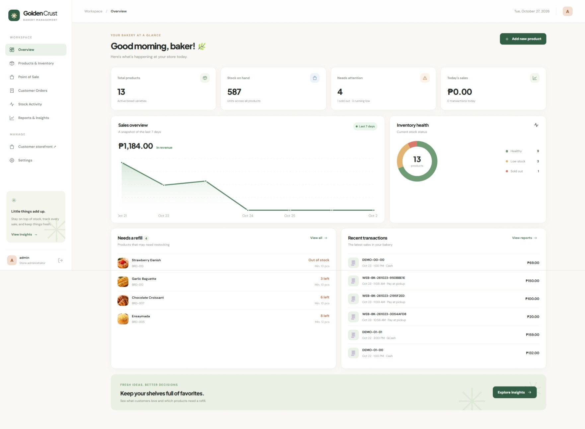
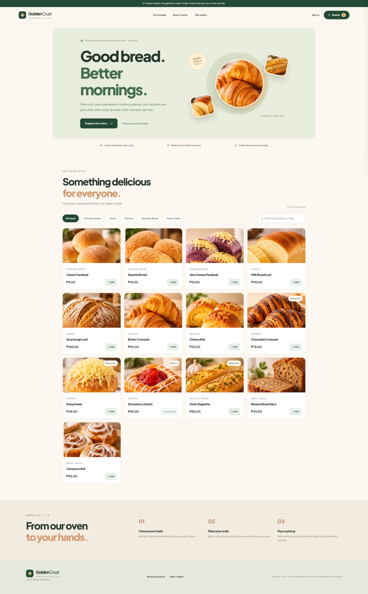
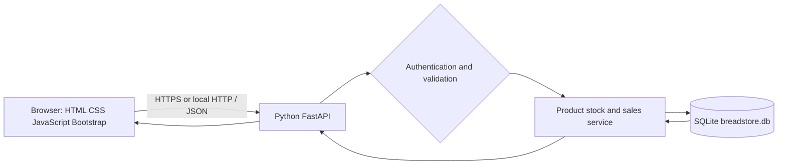
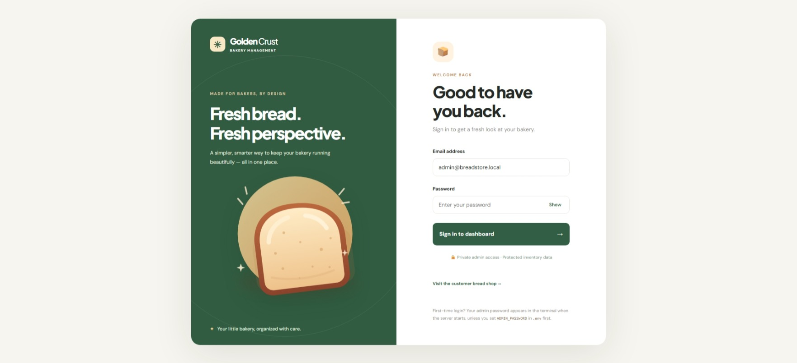
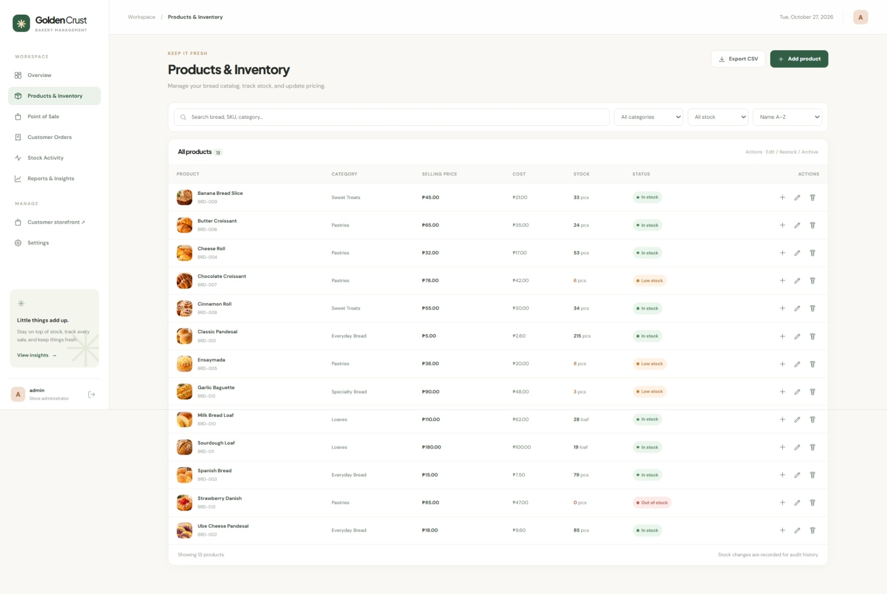
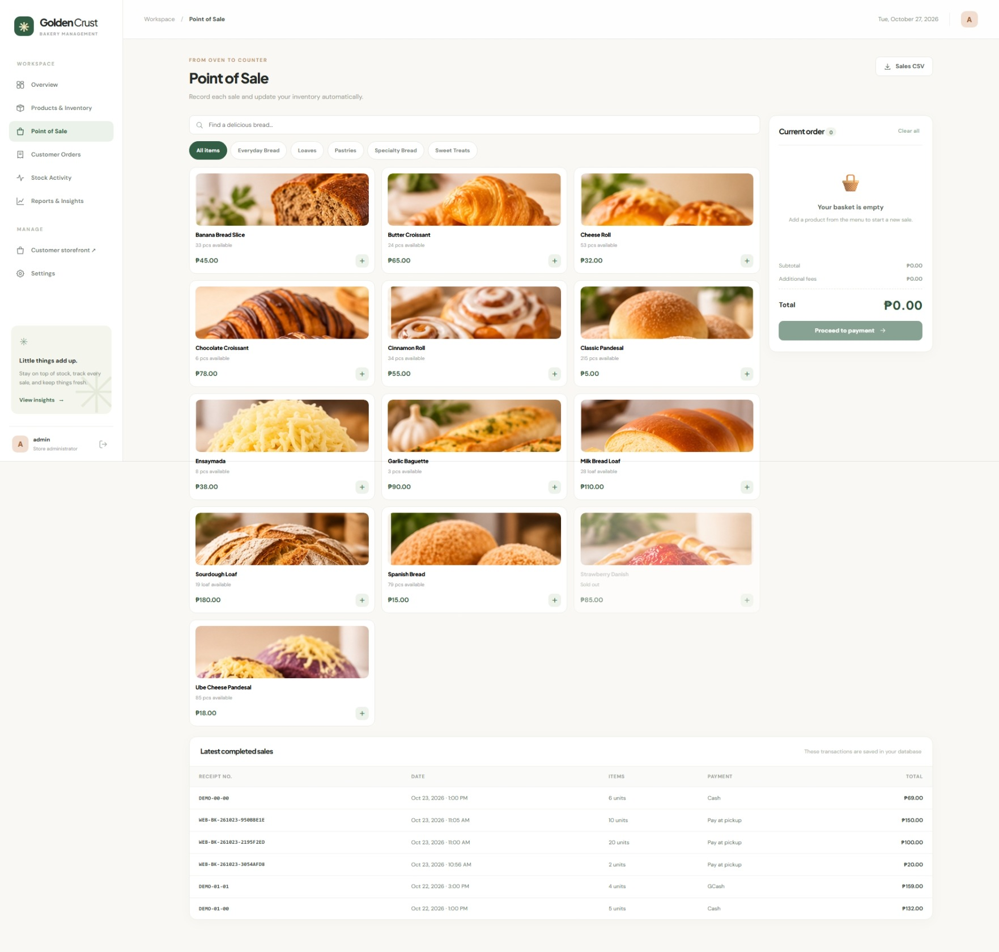
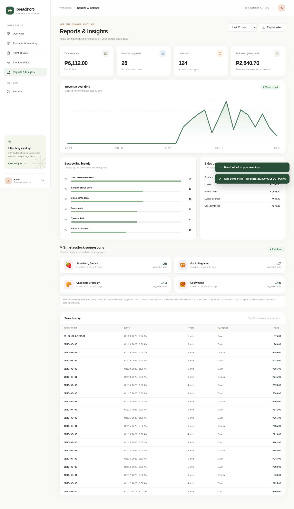
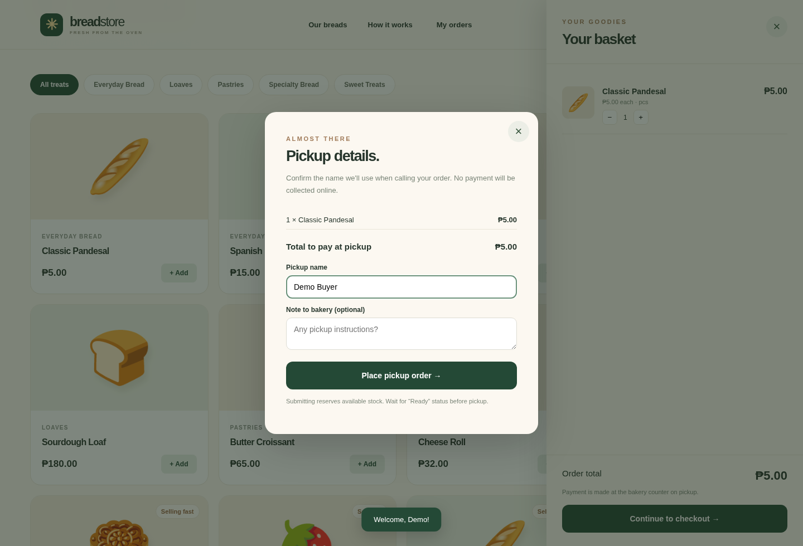
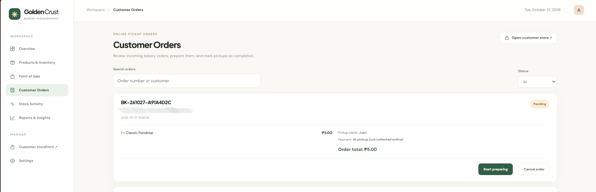

# Golden Crust — Bakery Inventory, Point of Sale & Customer Ordering System



Golden Crust is a web-based Bakery Inventory, Point of Sale,
and Customer Ordering Management System designed to help
small bakery businesses manage their daily operations.

The system provides two interfaces: an Admin Dashboard
for managing products, inventory, sales, customer orders,
and reports, and a Customer Website where users can browse
bread products, register, log in, and place pickup orders.

Developed using Python, FastAPI, SQLite, HTML, CSS,
JavaScript, and Bootstrap, the system demonstrates
database integration, CRUD operations, authentication,
validation, and web application development.

This project serves as Project 1: Web/Application
Development for our BSIT Industry-Ready Portfolio.

> **Status:** Local runnable project with integration tests. **Not yet publicly deployed.** Screenshots show example demonstration data, not a real operating business.

## ⭐ Upgrade: Customer Ordering (Version 2)

**Two working interfaces share one SQLite database:**

- **Admin:** `http://127.0.0.1:8000/` — dashboard, product CRUD, POS, reports, stock activity and **Customer Orders**.
- **Customer:** `http://127.0.0.1:8000/shop` — public bread catalog, search/category filter, basket, registration, login, pickup order submission, tracking, and cancellation of pending orders.

**IMPORTANT — if you already used the previous BreadStore project:** See **`UPGRADE_EXISTING_PROJECT.txt`** before replacing any files. In particular, **preserve `data/breadstore.db` and `.env`** to keep your existing products, sales and administrator password. Starting the upgraded code adds new database tables automatically without deleting old records. Customers create their own logins; they **do not** use the admin credentials. No online payment integration is provided: customers pay in person at pickup.



## 1. Project title

**GoldenCrust: Bakery Inventory, Sales and Customer Pickup Ordering System**

## 2. Project overview

GoldenCrust helps a bakery owner or cashier record their products, monitor inventory, process customer sales, and understand which breads need replenishment. Unlike a static website, it has a **real SQLite database** stored at `data/breadstore.db`, keeping data between server restarts.

## 3. Problem statement

Small bakeries may keep stock and sales records in notebooks or separate spreadsheets. Manual tracking can lead to inventory discrepancies, duplicated product records, missed low-stock items, and difficulty reviewing revenue and best-selling products. GoldenCrust provides one consistent system for these tasks.

## 4. Objectives

- Create a responsive, accessible-to-use interface for bakery staff.
- Store records in a normalized relational database.
- Provide product **Create, Read, Update, Delete (archive)** functions.
- Validate input to prevent invalid pricing, SKU conflicts and negative stock.
- Provide SKU/name/category search and filtering.
- Restrict access to authenticated administrators.
- Record sales and deduct inventory in a **single database transaction**.
- Produce revenue reports and estimated product reorder quantities.
- Handle errors clearly and keep stock movement history.

## 5. Target users

Bakery administrators and owners (admin dashboard); customers who want to order baked goods for counter pickup (customer storefront). Separate cashiers with individualized staff accounts are not implemented yet.

## 6. Technologies used

| Layer | Technology | Purpose |
|---|---|---|
| UI | HTML5 | Page structure, forms, tables |
| Styling | CSS3, Bootstrap 5 (CDN) | Responsive layout and style |
| Browser logic | Vanilla JavaScript | UI navigation, validation, API requests |
| Backend | Python 3.10+, FastAPI | REST endpoints and business logic |
| Database | SQLite 3 (Python standard library) | Persistent relational tables and SQL queries |
| API validation | Pydantic (via FastAPI) | Type and range validation |
| Security | PBKDF2-HMAC-SHA256, random session tokens | Password hashing and authenticated sessions |
| Tests | pytest, FastAPI TestClient (httpx) | API integration tests |
| Version control | Git & GitHub (user uploads project) | Source repository and evidence |

**Network notes:** Core styles are included locally. Bootstrap and Google Fonts are loaded by optional CDNs, so the custom design still works if these external resources are blocked.

## 7. System features

| Feature | Description |
|---|---|
| Administrator login | Random-password or `.env`-configured account, HttpOnly session cookie, logout |
| Dashboard | Stock metrics, sales overview, inventory health, latest sales |
| Customer storefront | Public catalog, bread search, category filters and stock availability |
| Customer accounts | Registration, login, logout and stored order history; separate customer sessions |
| Online pickup order | Add to basket, submit order and reserve inventory in one SQL transaction |
| Pickup management | Admin views new orders, marks Preparing → Ready → Completed, or cancels |
| Order cancellations | Pending customer orders can be cancelled; stock reservation is reversed exactly once |
| Payment | Pay at bakery counter; completing pickup adds one sale to existing POS reports |
| Product management | Add, view, edit and archive products without destroying historical orders |
| Inventory control | Restock, adjust, log damage/waste or correction; prevent negative quantities |
| Search and filters | Product name, SKU, category, stock status, sorting |
| Point of sale | Add items to cart, validate availability, accept Cash/GCash/Card entries, save sale |
| Sales history | Stored receipts, historical prices and purchase line items |
| Stock audit | Movement ledger for opening stock, sales and manual adjustments |
| Reporting | 7/30/90-day charts, revenue, estimated gross profit, best sellers, category totals |
| Reorder suggestions | Rules based on minimum stock and sales velocity (see below) |
| CSV export | Products and sales data for spreadsheet analysis |
| Password management | Authenticated change-password and local-only recovery utility |
| Error handling | Input errors, duplicate SKU, expired sessions, insufficient stock, missing records |

**Reorder feature accuracy:** This is **not an AI or machine-learning model**. It is a deliberately explainable rule:

```text
Average daily demand = units sold during previous 14 days / 14
Target stock = MAX(2 * minimum_stock, CEIL(average_daily_demand * 7) + minimum_stock)
Suggested reorder = MAX(0, target_stock - current_stock)
```

Suggestions apply to items at or below their configured minimum stock and should be checked by a human. The course PDF's **suggested** AI-assisted inventory system is an optional later enhancement; this version does not claim to deliver real artificial intelligence.

## 8. System architecture



- Admin browser reads/writes through authenticated `/api/*` endpoints; customer `/api/shop/products` is public and customer orders require a separate customer session.
- FastAPI validates payloads and performs parameterized SQL.
- SQLite maintains products, POS sales, customer pickup orders, stock logs, admin credentials and customer accounts.
- A checkout uses `BEGIN IMMEDIATE`; if any requested product is unavailable, the entire sale is rolled back.
- Product archive (`DELETE /api/products/:id`) is implemented as **soft deletion** (`archived=1`), preserving past orders.

See [System design and ERD](docs/SYSTEM_DESIGN.md), [standalone SQL schema](schema.sql) and [example SQL queries](docs/sample_queries.sql).

## 9. Database design

| Table | Purpose |
|---|---|
| `users` | Administrator credentials (salt and password hash) |
| `sessions` | Server-backed authentication cookies (token hashes only) |
| `products` | Bread SKU, name, category, cost, price, stock, reorder threshold, archive status |
| `stock_movements` | Changes in inventory with timestamp, reason and who acted |
| `sales` | Receipt number, method, total and time of each sale |
| `sale_items` | Line items including **price and cost at time of sale** |
| `customers` | Separate customer profile with salted password hash |
| `customer_sessions` | Customer login session token hashes and expirations |
| `customer_orders` | Pickup order number, owner, status, total, linked completed sale |
| `customer_order_items` | Reserved product quantities and historical prices at order time |

Prices are stored as **integer centavos** to avoid floating-point rounding errors. All tables are created automatically on first launch. SQL queries use `?` parameters, not string interpolation of user-entered data.

## 10. Screenshots

| Page | Preview |
|---|---|
| Login |  |
| Dashboard |  |
| Inventory |  |
| Point of Sale |  |
| Reports |  |
| Customer shop |  |
| Customer checkout |  |
| Admin pickup orders |  |

## 11. Installation (Windows / VS Code)

**Requirements:** Python 3.10 or newer, Python added to PATH, an internet connection for the **initial** Python package installation, and a modern browser.

1. Download and extract this ZIP, then open the **`BreadStore-Inventory`** folder in VS Code.
2. Open **Terminal → New Terminal** and run:

   ```powershell
   py -m venv .venv
   .\.venv\Scripts\Activate.ps1
   pip install -r requirements.txt
   ```

   If PowerShell blocks the activation script, open **Command Prompt** and run `.venv\Scripts\activate.bat`, or use `.venv\Scripts\python.exe` instead of `python`.

3. (Recommended) Create your administrator password before the first run:

   ```powershell
   copy .env.example .env
   ```

   Open `.env` in VS Code. Change `ADMIN_PASSWORD` to a **unique, strong** password. **Never commit `.env` to GitHub.**

4. Start the web server:

   ```powershell
   python -m uvicorn app:app --reload
   ```

5. Open **http://127.0.0.1:8000** in your browser.
6. Log in as `admin@breadstore.local` (unless you changed `ADMIN_EMAIL`) with the password you selected in `.env`.

**If you skipped `.env`:** The server creates a long random password on first launch and **prints it once to the terminal**. Use the printed password. `data/breadstore.db` is automatically generated, and demo products/sales are added on first launch.

**Note:** Changing `ADMIN_PASSWORD` in `.env` **after** the first database creation does not overwrite the existing password. Use the authenticated Settings screen, or reset locally:

```powershell
python admin_tools.py --email admin@breadstore.local
```

A local terminal prompt requests and confirms the new password. This command **invalidates existing sessions**.

To use a different data location or skip sample data, configure `.env` with `DB_PATH=./data/my-shop.db` and `SEED_DEMO=false` **before the first run**. Do not delete an active shop database to reset demo data: doing so permanently destroys your records.

## 12. How to use

1. Log in with the administrator credentials.
2. Inspect the dashboard for daily revenue and products needing attention.
3. Open **Products & Inventory** to add bread, set minimum stock and set cost and selling price.
4. Search by SKU/name; edit catalog entries using the pencil button.
5. Use the **+** button on an inventory row to record a restock, damaged stock, or a correction. A movement is saved.
6. Open **Point of Sale**, add bread to the cart and proceed to payment. Choose Cash, GCash or Card; the system records the selected method but **does not process actual electronic payments**.
7. Review **Stock Activity** to see a trace of each change.
8. Open **Reports & Insights** to analyze sales and see suggested reorder quantities. Export CSV if needed.
9. Open **Customer Orders** to review pickup orders and mark them Preparing, Ready and Completed (when paid and picked up), or Cancelled.
10. Open **/shop** in a private window to register as a customer, add bread to basket, place a pickup order and check its status.
11. Use **Settings** to change your admin password or sign out.

## 13. Testing and validation

**Eleven automated API integration tests passed** in the supplied environment, using isolated temporary SQLite databases. Tests cover authentication, unauthorized writes, login, product CRUD, search, archive/restore, invalid entries, stock controls, transaction rollback, successful checkout, financial reports, CSV and password changes.

Run them on your computer:

```powershell
pip install -r requirements-dev.txt
python -m pytest -q
```

An original browser UI walkthrough covered the admin login, dashboard, product creation, inventory search, checkout and reports. It used a browser-side API bridge to the real app test client because direct browser network navigation was blocked in the build environment; it **does not replace your own manual browser test after local deployment**.

See [test cases and actual results](docs/TESTING.md) for a reproducible demonstration script and an unfilled manual test checklist.

## 14. Limitations

- Single administrator role and self-registered customer accounts; no separate cashier permissions, multiple-store support or supplier orders.
- Cash, GCash and Card in staff POS are **record-only** methods; online pickup orders are **pay at pickup only**. No payments are captured, confirmed or processed automatically.
- No real AI model; restock estimates use transparent rules and can be inaccurate with sparse historical sales.
- SQLite is best suited to a single modest deployment, not large multi-server operations.
- Screenshots are from seeded demonstration data, not a deployed production business.
- Pickup is in person; delivery addresses, shipping, contact notifications, PDF receipts and barcode scanner integration are not included yet.
- Production security requires **HTTPS** and `COOKIE_SECURE=true`.
- Database backups and periodic cleanup should be scheduled before real-world use.

## 15. Future improvements

Add cashier/manager roles, supplier purchase orders, barcode scanning, printable receipts, expiration-date alerts, multi-branch tracking, deployment with PostgreSQL, and optional demand forecasting using a genuinely trained or evaluated statistical/ML model with documented accuracy. A student could also export SQL and sales data into Excel or Power BI for a separate **Project 2: Data / Database Project**.

## 16. Developer and contributors

## 16. Developer and Contributors

**Project:** GoldenCrust Inventory and Customer Ordering System

**Project Developer:** [FERICK N. CORTIZO]

**Program:** Bachelor of Science in Information Technology

**Project Type:** Web/Application Development

**Group Members:**
- [FERICK CORTIZO]
- [SOFIA BIANCA JUNTO]
- [CYRUS HARVEY VICENTE]

**My Contribution:**
- GoldenCrust system development and testing
- Database integration and verification
- Admin and customer functionality testing
- Project documentation

**GitHub Repository:** https://github.com/Frostner/BreadStore-Inventory-System

**Live Website:** https://golden-crust-demo.onrender.com

**Admin Dashboard:** https://golden-crust-demo.onrender.com/

**Customer Website:** https://golden-crust-demo.onrender.com/shop

**AI Assistance:** AI tools were used during development.
The system was tested and verified locally.