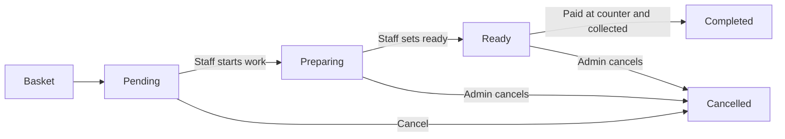
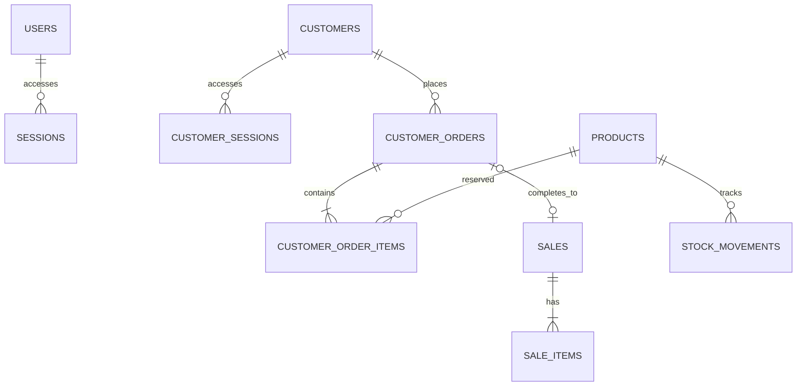

# Customer Storefront, Order Lifecycle and Database (Version 2)

## Purpose
Extend the existing admin inventory and Point-of-Sale project to support actual customer accounts and online **pickup** ordering. Admin and customer interfaces share one SQLite data store.

## Interface paths
- `/` — staff / admin login and dashboard
- `/shop` — public product catalog and customer basket
- `/api/shop/products` — public sanitized catalog (no product cost price)
- `/api/shop/register`, `/api/shop/login`, `/api/shop/logout`, `/api/shop/me` — customer authentication
- `/api/shop/orders` — customer-owned order creation/history
- `/api/shop/orders/{id}/cancel` — cancellation while Pending
- `/api/customer-orders`, `/api/customer-orders/{id}` — admin-only fulfillment and status transitions

## Customer order lifecycle

- Placing an order requires a logged-in customer, validates server-side prices and quantities, and uses `BEGIN IMMEDIATE` to atomically reserve inventory. Online baskets cannot override product price.
- Customer may cancel only while Pending. Staff may cancel before Completed. Cancellation returns reserved stock once and records stock movement.
- Completing an order creates a single POS sale and sale line items from the saved order price snapshot. It **does not** deduct stock again. Revenue reports include completed pickup orders, not merely submitted orders.
- Pickup has no confirmed schedule, email notifications or payment processing. The admin is responsible for changing order status only after the actual real-world action.

## ERD, simplified

## Data structure
- `customers`: ID, full name, unique normalized email, salted password hash, timestamp.
- `customer_sessions`: per-customer hashed random token with expiration. Separate from admin sessions and cookies.
- `customer_orders`: unique order ID, customer, status, pickup name, optional note, total integer centavos, optional linked sale, timestamps.
- `customer_order_items`: product ID, product display name, quantity and price/cost snapshots in centavos.
- Existing `products`, `stock_movements`, `sales`, `sale_items`, `users`, `sessions` remain unchanged. SQL migrations use `CREATE TABLE IF NOT EXISTS`, not dropping old data.

## Security and limitations
- Parameterized SQLite queries, Pydantic validation, salted PBKDF2 password hashing, hashed session tokens and HttpOnly SameSite cookies.
- Customer session does not authorize admin API calls. Orders are scoped to the authenticated customer ID.
- Status transitions are checked on the server to prevent repeat completion/cancellation. Database stock changes are atomic.
- For public deployment: use HTTPS, `COOKIE_SECURE=true`, appropriate proxy protection, backups, privacy policy and further production hardening. This is a portfolio demonstration, not audited commercial software.

## Portfolio demo script
1. Staff adds one bakery product with stock of 10.
2. Customer visits `/shop`, registers and submits an order for 3.
3. Staff inventory shows stock 7; Customer Orders shows Pending. Sales report is unchanged.
4. Staff marks Preparing, Ready and Completed after simulated in-person payment/pickup.
5. Sales report now includes one pickup sale, stock remains 7 (not deducted twice).
6. For a second Pending order, cancel it and show reserved stock returning in Stock Activity.
7. Open the SQLite database viewer to inspect `customers`, `customer_orders`, `customer_order_items` and `sales`.
