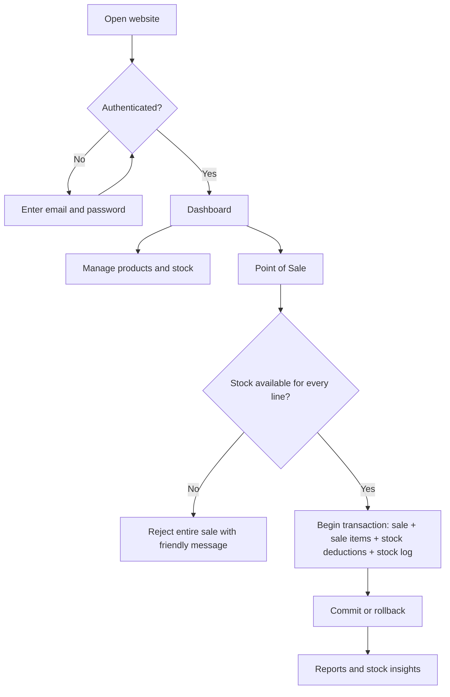
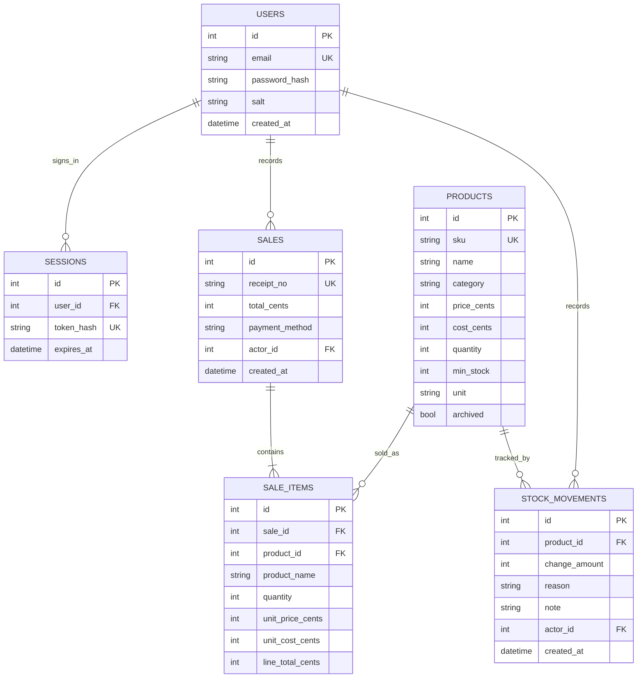

# System design — BreadStore

## Functional requirements

| ID | Requirement | Implementation |
|---|---|---|
| FR01 | Administrator login and logout | `/api/auth/login`, `/api/auth/logout` |
| FR02 | Create, browse, edit, archive and restore products | Products API, Inventory UI |
| FR03 | Reject negative stock, invalid prices, duplicate SKUs | Pydantic and SQLite constraints |
| FR04 | Search by product name, category or SKU | `/api/products?q=...` and UI filters |
| FR05 | Add and subtract inventory with audit trail | `/api/products/{id}/adjust` |
| FR06 | Record purchases and remove stock | `/api/sales` in one SQLite transaction |
| FR07 | Show dashboard, sale trends and profit estimates | `/api/overview`, `/api/reports` |
| FR08 | Recommend items to reorder | `/api/insights` deterministic rules |
| FR09 | Export inventory and sales for data analysis | CSV endpoint; spreadsheet-readable format |
| FR10 | Preserve order history when a product is deleted | Products use `archived=1` |

## Nonfunctional requirements

- Responsive interface for laptop, tablet and phone.
- Server-side input checking regardless of browser validation.
- Passwords stored as salted PBKDF2 hashes, not plaintext.
- Authentication by HttpOnly, SameSite=Strict session cookie; only hashes of random tokens are stored in DB.
- Required custom request header and same-origin check for writes, with no cross-origin access enabled.
- SQL parameters (`?`) and foreign keys.
- Atomic checkout with concurrency-aware `BEGIN IMMEDIATE` and rollback on error.
- Consistent storage of prices in integer centavos; stock cannot go below zero.
- Friendly validation and business-rule messages instead of raw database stack traces.

## Existing vs proposed system

**Existing:** handwritten counts and daily sales records, with no automatic deduction or centralized dashboard. **Proposed:** the browser app calls a protected FastAPI backend connected to a SQLite database, with stock movements, sales line items and reporting views. This existing-system description is a hypothetical small-bakery scenario to be tailored to your chosen real case study; it is **not claimed to be research observations from a specific business**.

## Actor/use-case list

**Administrator:** logs in, creates products, changes product details, searches and filters, adjusts quantity, archives/restores products, sells goods, views records and reports, downloads exports, and changes password. **Customer:** not a direct system user; a cashier/admin enters the sale at the register.

## High-level workflow



## Entity-relationship diagram



## Database invariants and formulae

1. `products.quantity >= 0`; one SKU may only exist once, even across archived products.
2. Recorded sale total is the sum of the sale items' stored quantity × stored unit price.
3. Sale item price/cost is a snapshot. Later price changes must **not** change past sales.
4. Every checkout adds one `sales` row and one or more `sale_items` and `stock_movements` rows, and decrements all relevant products — or none at all if an error occurs.
5. Estimated gross profit is `sales revenue − recorded unit costs`. It excludes rent, payroll, wastage, tax, discounts and overhead; it is **not net profit**.
6. Reorder suggestion is a deterministic approximation. See README.

## Primary API endpoints

| Method | Path | Action |
|---|---|---|
| `GET` | `/api/health` | Database health (public) |
| `POST` | `/api/auth/login` | Sign in |
| `GET` | `/api/auth/me` | Who is signed in? |
| `POST` | `/api/auth/logout` | Sign out |
| `POST` | `/api/auth/change-password` | Change password |
| `GET` | `/api/products` | Search/filter products |
| `POST` | `/api/products` | Create new bread |
| `PUT` | `/api/products/{id}` | Update product |
| `DELETE` | `/api/products/{id}` | Archive product |
| `POST` | `/api/products/{id}/restore` | Restore product |
| `POST` | `/api/products/{id}/adjust` | Record stock adjustment |
| `GET` | `/api/stock-movements` | Stock audit trail |
| `POST` | `/api/sales` | Check out order |
| `GET` | `/api/sales` | Read saved orders |
| `GET` | `/api/overview` | Dashboard aggregates |
| `GET` | `/api/reports?days=30` | Reports |
| `GET` | `/api/insights` | Restock suggestions |
| `GET` | `/api/export/products` | Product CSV |
| `GET` | `/api/export/sales` | Sale-line CSV |

Authenticated browser write requests must include `X-Requested-With: BreadStore`. The interactive Swagger documentation is at `/api/docs`; documentation visibility does not bypass API authentication.

## User interface sections

Login, Overview, Products & Inventory, Point of Sale, Stock Activity, Reports & Insights, Settings. Mobile menu is included for smaller screens.

## Implementation structure

```text
BreadStore-Inventory/
├── app.py                  # FastAPI routes and business rules
├── database.py             # SQLite schema, password hashing, seed data
├── admin_tools.py          # Local-only password recovery
├── static/
│   ├── index.html          # UI shell and sign-in
│   ├── app.js              # SPA views, forms, cart and API integration
│   ├── style.css           # Responsive custom theme
│   ├── icons.svg           # Local icon sprite
│   └── bread-art.svg       # Original SVG bread illustration
├── tests/test_api.py       # Automated integration tests
├── docs/                   # Project evidence and demo screenshots
├── requirements*.txt
└── README.md
```


## Version 2: Customer Ordering Extension

This design now also supports a public customer catalog and pickup ordering using the same SQLite database. See [Customer Ordering architecture, status workflow and ERD](CUSTOMER_ORDERING.md). New tables are `customers`, `customer_sessions`, `customer_orders`, and `customer_order_items`. Admin order fulfillment requires staff authentication, and customer history requires the corresponding customer session.
